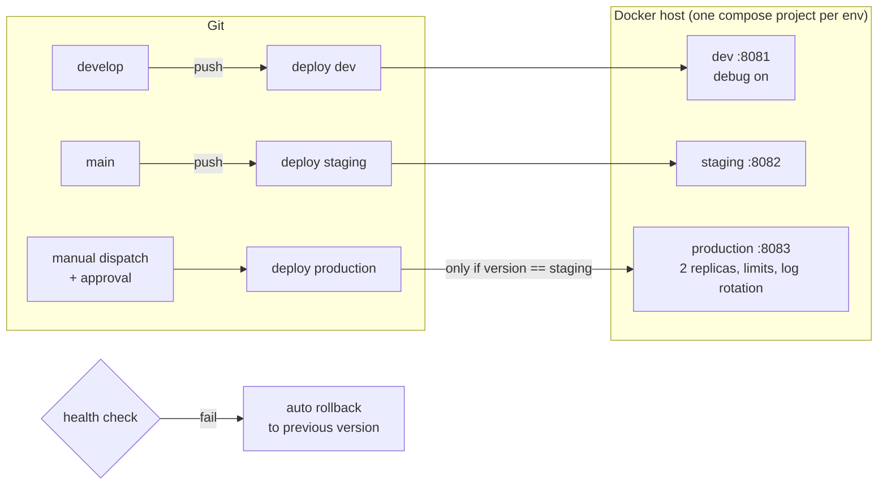

# Multi-Environment Deployment Pipeline


A deployment workflow that moves the same Docker image through **dev → staging → production**. Each environment has its own configuration, health-checked deploys, **automatic rollback** when a release is unhealthy, manual rollback to any earlier version, and a guard that stops untested versions reaching production.

> Portfolio project. CI runs all three environments side by side on the GitHub runner. It deliberately ships a broken release to prove the rollback works.

## Architecture



## How it works

| Concern | Implementation |
|---|---|
| Environment isolation | Each environment is its own Compose project (`-p dev`, `-p staging`, `-p production`), with its own port, containers and network |
| Environment-specific variables | `environments/<env>.env` holds the port, debug flag and log level. Production also loads `docker-compose.production.yml` for replicas, CPU/memory limits and log rotation. |
| Automated deployment | `scripts/deploy.sh <env> <version>` brings the stack up and waits for Docker health, then polls `/health` through Nginx |
| Rollback strategy | **Automatic:** if the new version never becomes healthy, the previously recorded good version is redeployed. **Manual:** `scripts/rollback.sh <env> [version]` goes back to the last good version or a named one. |
| Promotion guard | Production refuses any version that isn't currently running in staging. `ALLOW_UNTESTED=true` overrides this, and rollbacks use it. |
| Audit trail | `.deployments/<env>.history` records every deploy, failure and rollback with a timestamp |
| Visibility | `scripts/status.sh` shows each environment's version, port and health |

## Try it locally

```bash
git clone https://github.com/AmanMasood/multi-environment-deployment.git
cd multi-environment-deployment
docker build -t multienv-app:1.0.0 --build-arg APP_VERSION=1.0.0 app
docker build -t multienv-app:1.1.0 --build-arg APP_VERSION=1.1.0 --build-arg APP_BROKEN=true app

./scripts/deploy.sh dev 1.0.0
./scripts/deploy.sh staging 1.0.0
./scripts/deploy.sh production 1.0.0
./scripts/status.sh

./scripts/deploy.sh staging 1.1.0     # unhealthy -> automatically rolled back to 1.0.0
cat .deployments/staging.history
./scripts/rollback.sh dev             # manual rollback
```

Open http://localhost:8081, :8082 and :8083 to see each environment. Each one is colour-coded and shows its own config.

## Tests

- `tests/test_deploy.sh` unit-tests the deploy and rollback logic with fake `docker` and `curl` commands, so it runs anywhere in under a second:
  - promotion
  - the production guard
  - automatic rollback
  - manual rollback
  - an invalid environment
- The CI `e2e-environments` job runs the real thing with Docker on the runner.

## Tech stack

Docker · Docker Compose · Nginx · Bash · GitHub Actions (environments, branch-based deploys, manual approval) · Linux · Python/Flask

## License

MIT
